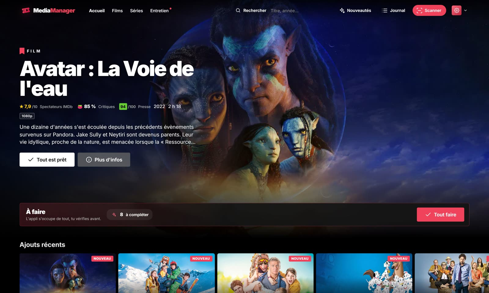
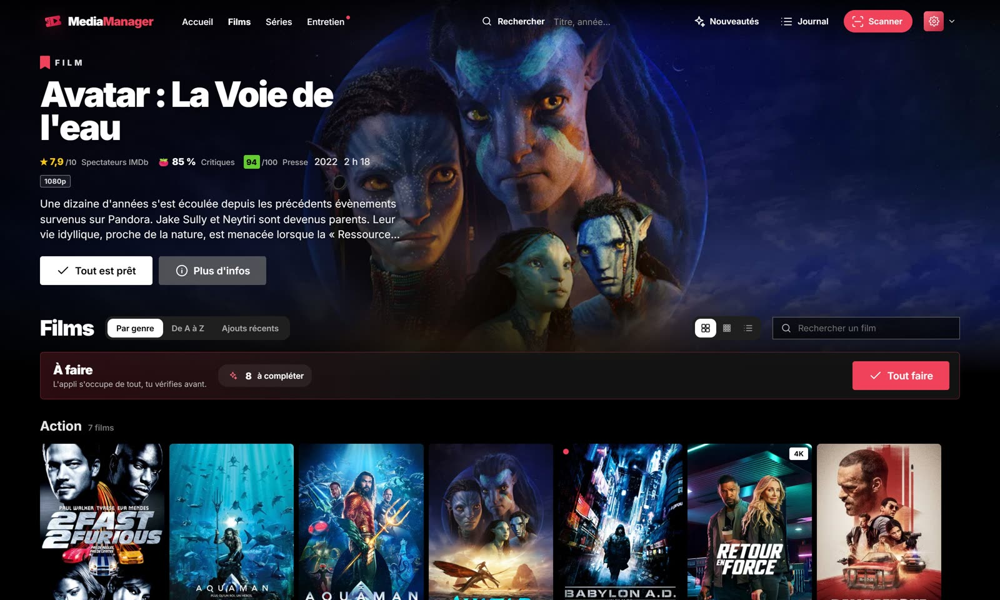
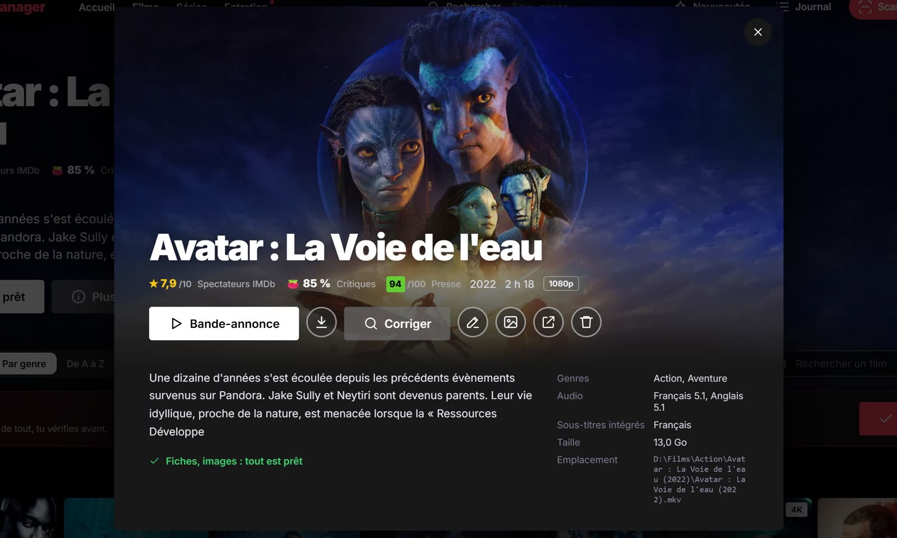
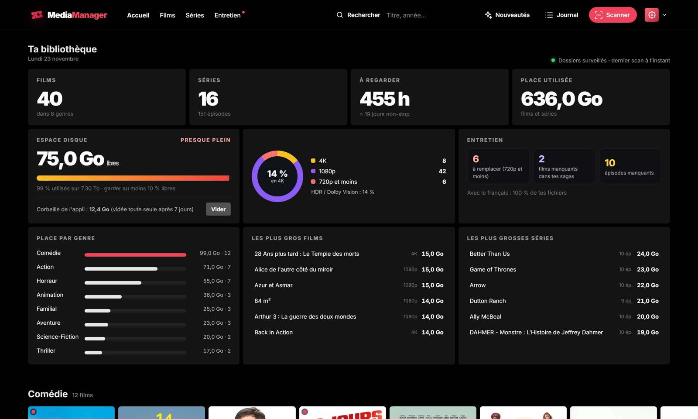
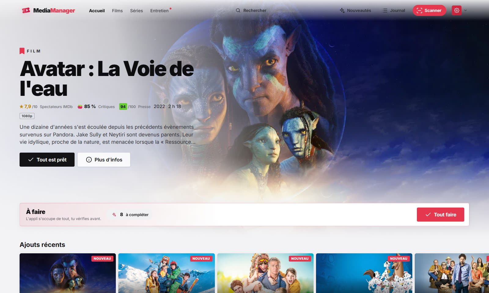

# MediaManager

**Ta bibliothèque de films et séries, rangée et complète — automatiquement.** 
Faite pour **Jellyfin**, **Plex**, **Kodi** et **Emby**. Gratuite, pour Windows.

[**⬇ Télécharger**](https://github.com/dev-webxdev/mediamanager-releases/releases/latest) &nbsp;·&nbsp;
[Nouveautés](https://github.com/dev-webxdev/mediamanager-releases/releases) &nbsp;·&nbsp;
[Signaler un bug](https://github.com/dev-webxdev/mediamanager-releases/issues/new/choose) &nbsp;·&nbsp;
[🇬🇧 English version](README.md)

 

---

## ✨ Pourquoi MediaManager ?

Jellyfin et Plex ne sont bons que si tes fichiers le sont. Des films mal nommés sont mal reconnus, les affiches manquent, les épisodes sont dans le désordre, les sous-titres introuvables.

**MediaManager règle tout ça en un clic** — et te montre tout avant de toucher au moindre fichier.

<table>
<tr>
<td width="50%" valign="top">

### 🎬 Comme une plateforme de streaming
Grande affiche, rangées par genre, fiches détaillées avec notes IMDb, Rotten Tomatoes et Metacritic, bandes-annonces. Grandes affiches, petites affiches ou liste.

### 🧾 Des fiches complètes pour ton lecteur
Fiches NFO, affiches, fonds, logos, miniatures d'épisodes et sous-titres dans ta langue : Jellyfin, Plex, Kodi et Emby affichent tout, sans chercher eux-mêmes.

### 🗂️ Bien rangé, avec un aperçu
Renommage propre, rangement par genre et par saga. Tu vois toujours un aperçu, et **chaque action s'annule**, même longtemps après.

</td>
<td width="50%" valign="top">

### 🧹 L'entretien en automatique
Sagas à compléter, films et épisodes manquants (et ceux qui vont sortir), doublons (en gardant toujours la meilleure copie), films à remplacer par une meilleure qualité.

### 🔔 Jellyfin et Plex à jour tout de suite
Après chaque changement, MediaManager demande à Jellyfin et/ou Plex d'actualiser leur bibliothèque. Connexion en un clic : l'appli ne voit jamais ton mot de passe.

### 🛡️ Tes fichiers en sécurité
Les vidéos ne sont jamais modifiées. Une suppression passe par une corbeille annulable pendant 7 jours, rien n'est jamais écrasé, et un déplacement interrompu est remis en place tout seul.

</td>
</tr>
</table>

**Et aussi :** les animés à numérotation continue (`[Groupe] Titre - 1071`), la détection automatique des nouveaux fichiers sur ton NAS, la modification d'une fiche à la main et le choix des images, un thème clair ou sombre qui suit Windows, le français et l'anglais, les mises à jour automatiques.

## 📸 Captures

<table>
<tr>
<td>
<b>Tes films, rangés par genre</b>
</td>
<td>
<b>Fiche détaillée : notes, qualité, bande-annonce</b>
</td>
</tr>
<tr>
<td>
<b>Ta bibliothèque d'un coup d'œil</b>
</td>
<td>
<b>Thème clair (ou sombre, comme Windows)</b>
</td>
</tr>
</table>

## 📥 Installation

1. **Télécharge** `MediaManager-Installer_x.y.z.exe` dans la [dernière version](https://github.com/dev-webxdev/mediamanager-releases/releases/latest).
2. **Lance-le.** Si Windows affiche *« Windows a protégé votre ordinateur »*, clique sur **Informations complémentaires** → **Exécuter quand même**.  Cet avertissement vient du fait que l'appli est nouvelle et pas encore signée numériquement : ce n'est pas le signe d'un problème.
3. **Laisse-toi guider.** Au premier lancement, MediaManager règle tout avec toi : langue, ta clé TheMovieDB gratuite, noms de fichiers, ton lecteur (Jellyfin / Plex) et tes dossiers. Puis il analyse ta bibliothèque.

**Il te faut :** Windows 10 ou 11 (64 bits) · un compte gratuit [TheMovieDB](https://www.themoviedb.org/) · tes films et séries sur ton PC, un disque externe ou un NAS.

Les mises à jour s'installent toutes seules. Pour désinstaller : *Paramètres Windows → Applications → MediaManager* (tes films ne sont jamais touchés).

## 🚀 Premiers pas

| | |
|---|---|
| **1. Ajoute tes dossiers** | Indique tes dossiers Films et Séries (sur le PC, un disque externe ou un NAS). |
| **2. Vérifie le plan** | L'appli reconnaît tout et te montre ce qu'elle va nommer, compléter et ranger — rien ne bouge sans ton accord. |
| **3. Clique sur « Tout faire »** | Fiches NFO, images, sous-titres et noms propres. Ton lecteur affiche tout tout de suite. |

## 🔌 Compatible avec

| Lecteur | Comment |
|---|---|
| **Jellyfin** | Lit directement les fiches NFO et les images · actualisé tout seul après chaque changement |
| **Plex** | Utilise les noms propres et les images · actualisé tout seul après chaque changement |
| **Kodi** | Lit directement les fiches NFO et les images |
| **Emby** | Lit directement les fiches NFO et les images |

## 🔒 Confidentialité

Rien de personnel ne quitte ton PC : pas de compte, pas de publicité, pas de serveur à nous. Tes réglages, tes clés et la liste de tes films restent sur ton ordinateur.

Pour compléter ta bibliothèque, l'appli contacte directement (avec tes propres clés) TheMovieDB, et si tu le choisis OpenSubtitles, OMDb, Fanart.tv, YouTube (bandes-annonces) et ton propre serveur Jellyfin / Plex. Elle vérifie les mises à jour sur GitHub et envoie une fois par jour un **signal anonyme d'utilisation** (seulement la version de l'appli : aucun nom, aucun fichier, aucun film), que tu peux couper dans *Réglages → Au démarrage*.

## ❓ Questions fréquentes

<b>C'est vraiment gratuit ?</b>

 Oui. Tout est compris, sans publicité et sans version payante.

<b>Est-ce que ça peut abîmer mes fichiers ?</b>

 Non. Les vidéos ne sont jamais modifiées : seuls leurs noms et dossiers changent, toujours après un aperçu. Chaque action s'annule depuis l'Historique, une suppression passe d'abord par une corbeille (7 jours), et si un déplacement est interrompu, tout est remis en place.

<b>Ça marche avec mon NAS ?</b>

 Oui, avec tout dossier réseau accessible depuis Windows (Synology, QNAP, partage Windows…). Les nouveaux fichiers sont même détectés tout seuls.

<b>Pourquoi Windows affiche un avertissement à l'installation ?</b>

 L'appli est nouvelle et pas encore signée numériquement, Windows SmartScreen ne la connaît donc pas encore. Clique sur <b>Informations complémentaires</b> → <b>Exécuter quand même</b>.

<b>Il faut une clé TheMovieDB ?</b>

 Oui, elle est gratuite : crée un compte sur themoviedb.org et demande une clé API (usage personnel). L'accueil guidé te montre exactement où cliquer. Les clés pour les sous-titres, les notes et les images en plus sont facultatives.

<b>Mac ou Linux ?</b>

 Windows seulement pour l'instant.

<b>J'ai trouvé un bug / j'ai une idée</b>

 <a href="https://github.com/dev-webxdev/mediamanager-releases/issues/new/choose">Ouvre un ticket</a> : un petit formulaire te guide. Pour un bug, <i>Réglages → « Un bug ? Ouvrir le journal technique »</i> te donne un fichier à joindre.

## 🙏 Crédits

&nbsp; Ce produit utilise l'API de TMDB mais n'est ni approuvé ni certifié par TMDB.

Sous-titres par [OpenSubtitles.com](https://www.opensubtitles.com) · notes par [OMDb](https://www.omdbapi.com) · images en plus par [Fanart.tv](https://fanart.tv). Jellyfin, Plex, Kodi et Emby sont des marques de leurs propriétaires respectifs ; MediaManager n'a aucun lien avec eux.

 Ce dépôt héberge les versions officielles de MediaManager.

