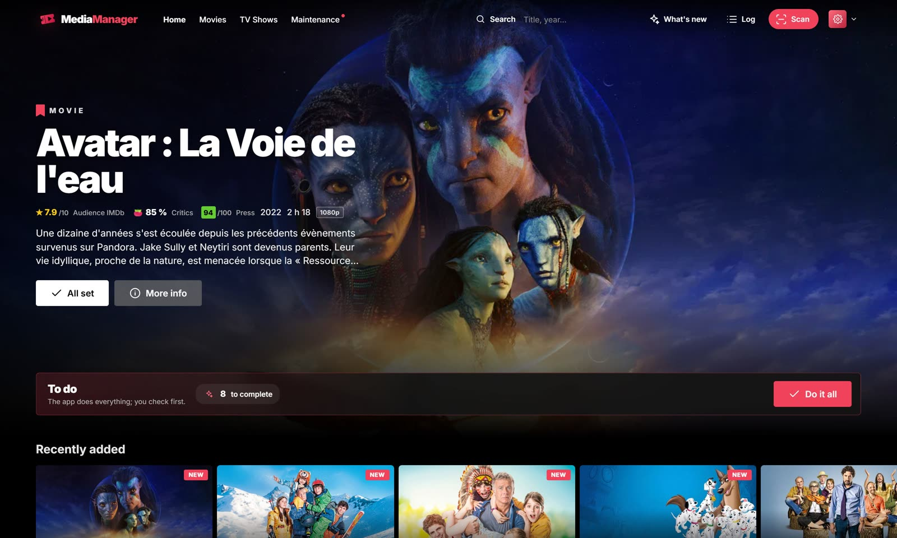
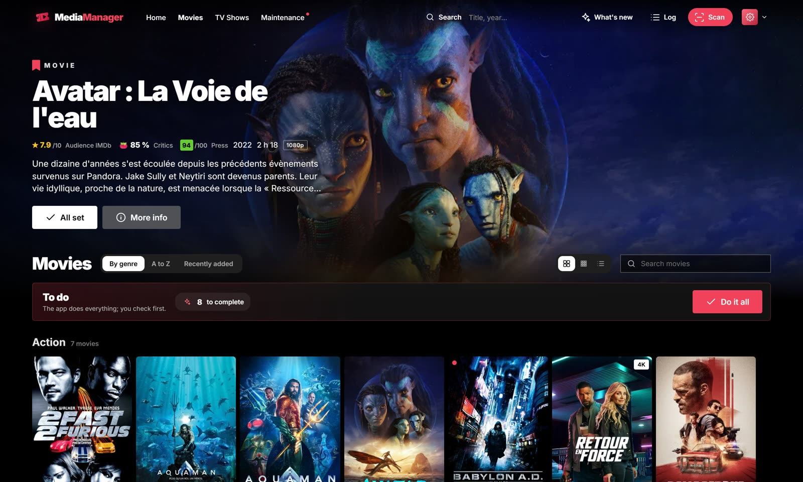
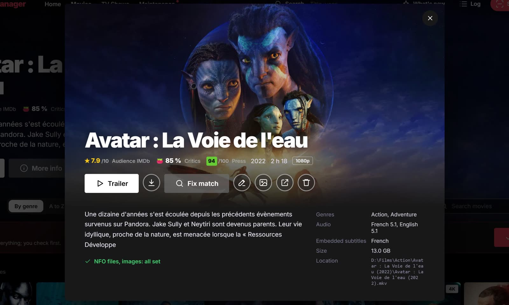
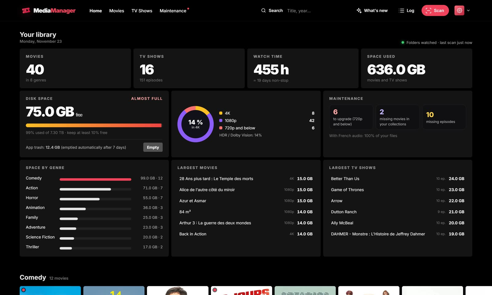
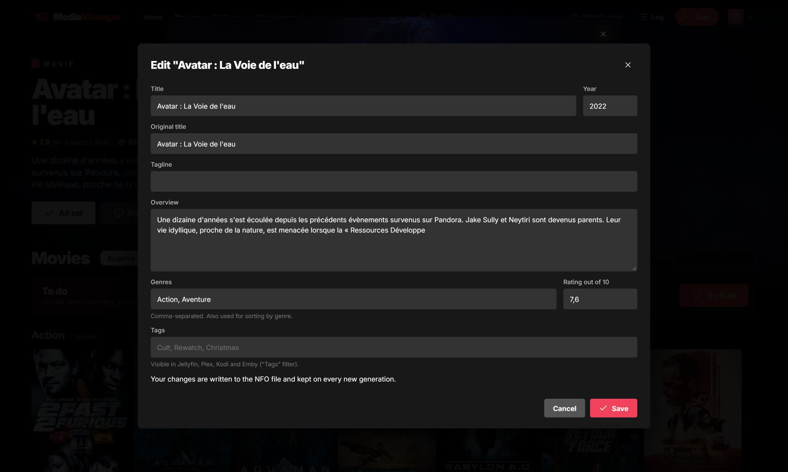

# MediaManager

**Your movie & TV library, organized and complete — automatically.** 
Built for **Jellyfin**, **Plex**, **Kodi** and **Emby**. Free, for Windows.

[**⬇ Download**](https://github.com/dev-webxdev/mediamanager-releases/releases/latest) &nbsp;·&nbsp;
[What's new](https://github.com/dev-webxdev/mediamanager-releases/releases) &nbsp;·&nbsp;
[Report a bug](https://github.com/dev-webxdev/mediamanager-releases/issues/new/choose) &nbsp;·&nbsp;
[🇫🇷 Version française](README.fr.md)

 

---

## ✨ Why MediaManager?

Media servers like Jellyfin and Plex are only as good as your files. Badly named movies end up misidentified, posters are missing, episodes are out of order, subtitles are nowhere to be found.

**MediaManager fixes all of that in one click** — and shows you everything before it changes a single file.

<table>
<tr>
<td width="50%" valign="top">

### 🎬 Like a streaming service
Big banner, rows by genre, detailed pages with IMDb, Rotten Tomatoes and Metacritic ratings, trailers. Large posters, small posters or a list.

### 🧾 Complete details for your player
NFO files, posters, backdrops, logos, episode thumbnails and subtitles in your language — Jellyfin, Plex, Kodi and Emby show everything without scraping themselves.

### 🗂️ Tidy, with a preview
Clean renaming, sorting by genre and by collection (sagas). You always see a preview, and **every action can be undone** — even much later.

</td>
<td width="50%" valign="top">

### 🧹 Maintenance on autopilot
Collections to complete, missing movies and episodes (and upcoming ones), duplicates (always keeping the best copy), low-quality movies to upgrade.

### 🔔 Jellyfin & Plex refresh instantly
After every change, MediaManager tells Jellyfin and/or Plex to refresh their library. One-click sign-in — the app never sees your password.

### 🛡️ Your files are safe
Video files are never modified. Deletions go to a trash you can undo for 7 days, nothing is ever overwritten, and interrupted moves roll back automatically.

</td>
</tr>
</table>

**And also:** anime with absolute numbering (`[Group] Title - 1071`), automatic detection of new files on your NAS, editing an item by hand and picking your artwork, light & dark themes that follow Windows, French and English, automatic updates.

## 📸 Screenshots

<table>
<tr>
<td>
<b>Your movies, by genre</b>
</td>
<td>
<b>Detailed page: ratings, quality, trailer</b>
</td>
</tr>
<tr>
<td>
<b>Your library at a glance</b>
</td>
<td>
<b>Edit any item by hand</b>
</td>
</tr>
</table>

## 📥 Installation

1. **Download** `MediaManager-Installer_x.y.z.exe` from the [latest release](https://github.com/dev-webxdev/mediamanager-releases/releases/latest).
2. **Run it.** If Windows shows *“Windows protected your PC”*, click **More info** → **Run anyway**.  This warning appears because the app is new and not yet digitally signed — it is not a sign of a problem.
3. **Follow the guide.** On first start, MediaManager walks you through everything: language, your free TheMovieDB key, file names, your player (Jellyfin / Plex) and your folders. Then it scans your library.

**Requirements:** Windows 10 or 11 (64-bit) · a free [TheMovieDB](https://www.themoviedb.org/) account · your movies and shows on your PC, an external drive or a NAS.

Updates install by themselves. To uninstall: *Windows Settings → Apps → MediaManager* (your movies are never touched).

## 🚀 Getting started

| | |
|---|---|
| **1. Add your folders** | Point MediaManager to your Movies and TV Shows folders (local, external drive or NAS). |
| **2. Check the plan** | It identifies everything and shows you what it will name, complete and sort — nothing moves without your approval. |
| **3. Click “Do it all”** | NFO files, artwork, subtitles and tidy names. Your player shows everything right away. |

## 🔌 Works with

| Player | How |
|---|---|
| **Jellyfin** | Reads the NFO files and artwork directly · refreshed automatically after each change |
| **Plex** | Uses the clean names and artwork · refreshed automatically after each change |
| **Kodi** | Reads the NFO files and artwork directly |
| **Emby** | Reads the NFO files and artwork directly |

## 🔒 Privacy

Nothing personal ever leaves your PC: no account, no ads, no server of ours. Your settings, keys and library list stay on your computer.

To complete your library, the app talks directly (with your own keys) to TheMovieDB, and optionally OpenSubtitles, OMDb, Fanart.tv, YouTube (trailers) and your own Jellyfin / Plex server. It checks GitHub for updates, and sends an **anonymous usage signal** once a day (only the app version — no name, no file, no movie), which you can turn off in *Settings → On startup*.

## ❓ FAQ

<b>Is it really free?</b>

 Yes. Everything is included, no ads, no paid version.

<b>Can it damage my files?</b>

 No. Video files are never modified — only their names and folders change, always after a preview. Every action can be undone from History, deletions go to a trash first (7 days), and if a move is interrupted everything is put back.

<b>Does it work with my NAS?</b>

 Yes, with any network folder reachable from Windows (Synology, QNAP, Windows share…). New files are even detected automatically.

<b>Why does Windows show a warning when I install it?</b>

 The app is new and not yet digitally signed, so Windows SmartScreen doesn't know it yet. Click <b>More info</b> → <b>Run anyway</b>.

<b>Do I need a TheMovieDB key?</b>

 Yes, it's free: create an account on themoviedb.org and request an API key (personal use). The first-start guide shows you exactly where to click. Keys for subtitles, ratings and extra artwork are optional.

<b>Mac or Linux?</b>

 Windows only for now.

<b>I found a bug / I have an idea</b>

 <a href="https://github.com/dev-webxdev/mediamanager-releases/issues/new/choose">Open an issue</a> — a short form guides you. For bugs, <i>Settings → “A bug? Open the technical log”</i> gives you a file you can attach.

## 🙏 Credits

&nbsp; This product uses the TMDB API but is not endorsed or certified by TMDB.

Subtitles by [OpenSubtitles.com](https://www.opensubtitles.com) · ratings by [OMDb](https://www.omdbapi.com) · extra artwork by [Fanart.tv](https://fanart.tv). Jellyfin, Plex, Kodi and Emby are trademarks of their respective owners; MediaManager is not affiliated with them.

 This repository hosts the official MediaManager releases.

